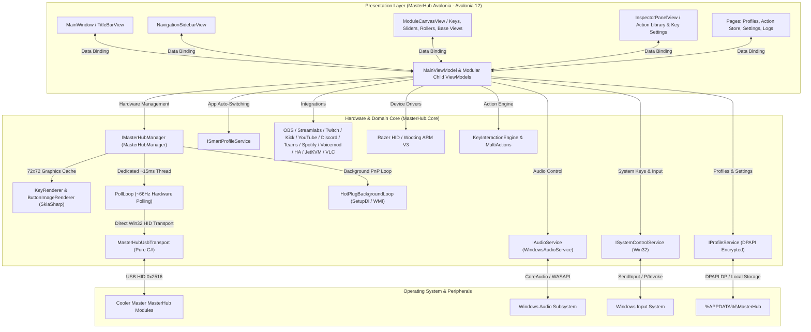

# Cooler Master MasterHub .NET Control Deck

[](https://dotnet.microsoft.com/)
[](https://avaloniaui.net/)
[](https://microsoft.com/windows)
[](docs/ARCHITECTURE.md)
[](docs/ARCHITECTURE.md#47-security--dpapi-encryption-secretprotectionservice)
[](LICENSE)

An ultra-fast, native **C# (.NET 10 & Avalonia 12)** control deck and hardware driver interface for the **Cooler Master MasterHub** modular stream deck and productivity workstation.

Engineered from the ground up to replace the official Electron-based software with a lightning-quick native desktop application that consumes **<38 MB of RAM**, delivers **sub-millisecond input responsiveness**, and includes a comprehensive **stream deck action engine**, **WASAPI audio mixer**, and **deep hardware/software integrations**.

---

<p align="center">
  
</p>

---

## ⚡ Why MasterHub .NET?

| Metric | Official MasterHUB (Electron) | MasterHub .NET (Native Avalonia 12) | Improvement |
| :--- | :---: | :---: | :---: |
| **RAM Usage** | ~480 – 550 MB | **~32 – 38 MB** | **~93% Less RAM** |
| **Input Latency** | 30 – 80 ms | **< 15 ms (~66Hz)** | **Zero noticeable lag** |
| **Startup Time** | 4 – 8 seconds | **< 0.8 seconds** | **~85% Faster** |
| **Process Count** | 5 – 7 Chrome/Node processes | **1 Single Native Process** | Clean task manager |
| **Audio Mixing** | High CPU overhead | **Native WASAPI / CoreAudio** | Instant per-process volume |
| **Hot-Plug Handling**| Often loses track of modules | **Instant seamless recovery** | Magnetic re-docking |
| **Privacy & Security**| Cloud telemetry & plain configs | **100% Local & DPAPI Encrypted** | Zero telemetry |

---

## 🎛️ Supported Hardware Modules

All modules connect magnetically to the MasterHub Base Dock and communicate via USB Vendor ID `0x2516`:

| Module | Model | Product ID | Capabilities Supported |
| :--- | :---: | :---: | :--- |
| **Base Station** | `MHBS01` | `0x01F6` | Magnetic bus powering, unified LED strip brightness & RGB color control, standby management, tilt orientation sensor (Feature `0x35`: 1=Horizontal, 0=Vertical) |
| **Key Deck 15** | `MHKD15` | `0x01FE` | 15 LCD color displays (72×72), real-time SkiaSharp graphics, animated GIF/MP4 loop decoding, dual-state toggles, panoramic wallpaper engine (`0x02 0x35`) |
| **Fader 5** | `MHFD05` | `0x0200` | 5 vertical faders (0–100%), per-channel RGB LEDs & brightness, analog deadband filtering, per-app WASAPI mixer |
| **3 Knobs** | `MHKB03` | `0x0202` | 3 rotary encoders with click switches, dynamic acceleration (1×/2×/3×), dedicated RGB LED rings (10 modes), volume/scrub/macro controls |
| **Roller 2** | `MHRR02` | `0x0204` | 2 dual-direction rotational dials with push buttons (Volume, Scroll, Track scrub, DPI/Profiles). *(Hardware has no LEDs)* |
| **Dial Display** | `MHDD01` | `0x0206` | High-resolution circular encoder with integrated central 240×240 IPS color display (`0x02 0x45` frame stream) and click switch |
| **IPS Display** | `M131` | `0x131E` / `0x1312` | Ultra-wide monitoring screen module detection |

---

## ✨ Features & Capabilities

### ⌨️ Stream Deck Action Engine & 72×72 LCD Graphics
- **Physical LCD Graphics**: Renders high-contrast 72×72 action cards with icons, custom text, and backgrounds using SkiaSharp and streams them directly to physical button displays.
- **Pre-Cached Zero-Latency Rendering**: Zero memory allocations or garbage collection stutter on button clicks.
- **Dual-State LCD Graphics**: Set two distinct graphics per key (**Default / State 1** and **Active / State 2**) for toggle actions like Mute/Unmute or Play/Pause, dynamically updating physical LCD pads in real time.
- **Animated Key Icons**: Supports animated GIF and MP4 loops with hardware-accelerated MediaFoundation decoding and cached frame playback.
- **Multi-Actions & Sequences**: Execute chains of actions with configurable delays (e.g. switch OBS scene, launch game, set audio volumes, mute mic).
- **Conditional Actions**: Execute different sub-actions based on application or system states.
- **Key Gestures**: Distinct triggers for Single Tap, Double Tap, Long Press, and Hold.

### 🎧 Windows Audio Mixer Subsystem (WASAPI / CoreAudio)
- **Assign Any Fader**: Bind each of the 5 hardware sliders to **Master Volume**, **Microphone Input Level**, or any running process/game (e.g., Spotify, Discord, Chrome, CS2).
- **Auto-Discovery of Audio Sessions**: Dynamic scanning of Windows audio endpoints to automatically populate active apps into dropdown selectors.
- **Instant Mute Toggles**: Dedicated deck keys toggle system or app mute states instantly.

### 🔄 Multi-Function Rotational Dials (Rollers)
- **Master Volume Dial**: Turn clockwise to increase volume, counter-clockwise to decrease volume.
- **Mouse Wheel Scrolling**: Smooth vertical or horizontal scrolling without touching the mouse.
- **Track Scrubbing**: Skip to next/previous tracks with a quick flick of the dial.
- **Hardware Profile Cycling**: Spin dials to step through DPI stages, Polling Rates (Hz), or Wooting keyboard profiles.

### 🧩 Elgato Stream Deck Plugin Ecosystem
- **Universal Plugin Host**: Full compatibility layer running official `.streamDeckPlugin` packages without requiring Elgato software.
- **Bi-directional WebSocket Loopback**: Standard Stream Deck registration protocol with bidirectional event routing (`keyDown`, `keyUp`, `willAppear`, `willDisappear`, `propertyInspectorDidAppear`).
- **Headless Browser Runner**: Puppeteer / Playwright headless Chromium/Edge integration executing HTML-based plugin scripts and canvases in background instances.
- **Dynamic SkiaSharp Compositor**: Real-time rendering of SVG, base64 PNG/JPEG, and HTML Canvas frames streamed from plugins directly onto 72×72 LCD displays.
- **Node.js & Native Runtimes**: Automatic execution and lifecycle management of Node.js and native binary plugins.
- **Plugin Store & Browser**: Search, inspect, install, configure, and remove plugins directly within MasterHub Studio.

### 🔌 Third-Party Integrations & Streaming Suite
- **Home Assistant**: Direct REST and live bidirectional WebSocket event-stream integration (Toggle lights, switches, triggers, sensors, and dial/roller light brightness).
- **OBS Studio**: Direct WebSocket v5 integration (Record, Stream, Scene Switch, Source Mute, Replay Buffer, Studio Mode Toggle & Transitions).
- **Streamlabs Desktop**: JSON-RPC 2.0 via WebSocket port 59650 and Named Pipe `\\.\pipe\slobs` for fast scene switching.
- **Twitch**: Helix API & chat client (Emote-Only, Slow Mode, Sub-Only, Clear Chat, Send Message, Clips, Markers, Raids, Commercials).
- **Kick**: Pusher WebSocket & Kick API (Chat modes, clear chat, send messages, create clips).
- **YouTube Live**: Official YouTube Data API v3 and keyless public scraping fallback for live status and concurrent viewer counter.
- **Discord**: Discord Local IPC RPC integration for microphone mute, deafen, camera toggle, screen share (Go Live), Push-To-Talk, and voice channel join.
- **Microsoft Teams**: Desktop meeting controls (Mute, Camera, Raise Hand, Leave Meeting) with automatic window focus restoration.
- **Spotify**: Web API playback control (Play/Pause, Next/Prev, Volume, Shuffle, Repeat, Like Track, Add to Queue, Play URI).
- **Voicemod**: Official Control API 1.0.0 (WebSocket + REST) with real-time voice changer toggle, "Hear Myself" feedback, live voice switching with soundboard, background voice FX toggle, and microphone mute.
- **JetKVM**: Remote KVM switching, mouse/keyboard forwarding, HDMI video toggle, ATX power short/long press, and hardware reset.
- **VLC Media Player**: HTTP remote control (Play, Pause, Stop, Volume, Next/Prev, Fullscreen).
- **Windows Media (GSMTC)**: Universal Now Playing engine extracting track title, artist, album, and artwork from Spotify, YouTube, VLC, and system media players without requiring API keys.

### 🖥️ Multi-Engine Hardware Telemetry & System Utilities
- **Direct GPU Telemetry**: DXGI (`dxgi.dll`) enumerates all physical GPUs; NVML (`nvml.dll`) extracts NVIDIA GeForce/RTX core temp and GPU load; AMD ADL2 (`atiadlxx.dll`) queries AMD Radeon and AMD Ryzen SoC/CPU metrics.
- **Real-Time Gaming FPS Counter**: RTSS Shared Memory (`RTSSSharedMemoryV2`) coupled with 3D foreground process detection for accurate gaming FPS (strictly 0 FPS on desktop).
- **System Counters**: Win32 PDH (`pdh.dll`) for CPU utility, PhysicalDisk read/write MB/s, and GPU 3D engine load; `GlobalMemoryStatusEx` for RAM and `NetworkInterface` for network speed.
- **LibreHardwareMonitor Fallback**: HTTP JSON reader (`http://127.0.0.1:8085/data.json`) for local hardware monitor servers.
- **Windows High-Res Icon Extractor**: Direct Win32 extraction (`SHDefExtractIconW`) pulling crisp, native 256×256 app icons for shortcuts without blurry scaling.
- **Cooler Master Profile Importer**: Seamless import and parsing of official MasterHub `.mhz` profiles, buttons, faders, knobs, and media assets.
- **Panoramic Wallpaper Engine**: Seamless 480×272 panoramic imagery sliced and streamed across Key Deck 15 LCDs via hardware command `0x02 0x35`.

### 🗔 Windows Desktop & Workflow Productivity
- **Virtual Desktops**: Switch Next/Previous, Create new (`Win+Ctrl+D`), and Close current (`Win+Ctrl+F4`).
- **Desktop Window Management**: Task View (`Win+Tab`), Show Desktop (`Win+D`), and Clipboard History (`Win+V`).
- **Multi-Page & Nested Folders**: Unlimited pages (`GoToPage`, `NextPage`, `PreviousPage`) and folder hierarchies with automatic return buttons (`GoBack`, `GoHome`).
- **Multi-Actions & Conditionals**: Execute complex sequential macro chains with delays or evaluate runtime conditional rules (IF process running THEN action ELSE action).

### 🐍 Direct Hardware Device Drivers
- **Universal Razer Mouse HID**: Direct sensor control via 90-byte Feature Reports. Change DPI stages (400–30,000 DPI), Polling Rate (125–8000 Hz), active onboard profiles (1..5), and read real-time battery status.
- **Wooting Analog Keyboard Driver**: Direct ARM V3 HID control (`UsagePage = 0x1337 / 0xFF55, Usage = 0x0001`). Switch between Digital Mode and Analog Profiles 1–3 (Rapid Trigger, Tachyon Mode, custom actuation).

### 🎯 Smart Profiles & Workspace Management
- **App-Aware Auto-Switching**: MasterHub detects the active foreground application and automatically activates matching profiles (e.g., automatically switches to Premiere profile when video editing, CS2 profile when gaming, or OBS profile when streaming).
- **Unlimited Custom Profiles**: Create, clone, rename, and export profiles with ease.

### 🔒 Security, Privacy & DPAPI Encryption
- **100% Local & Private**: Zero cloud telemetry, zero remote tracking, zero analytics beacons.
- **Windows DPAPI Encryption**: All sensitive tokens, passwords, and API keys (OBS, Twitch, Spotify, Discord, JetKVM, Voicemod, Streamlabs, YouTube) are encrypted on disk using **Windows DPAPI** (`ProtectedData.Protect` with app-level entropy) and stored with the `enc:v1:` prefix.
- **Hardware Safety Filter (`IsForbiddenReport`)**: Blocks hazardous opcodes (firmware updates, factory resets, tilt sensor decalibration `0x02 0x2F`, SPI flash writes).
- **Safe Profile Export**: Exporting profiles automatically strips passwords and credentials to ensure safe sharing with the community.
- **Clean Repository**: Profiles and settings reside in `%APPDATA%\MasterHub` and are strictly excluded from git tracking.

### 🌐 Multilanguage (i18n)
- Out-of-the-box multilingual support: **Polish (PL)**, **English (EN)**, **German (DE)**, **Spanish (ES)**, **French (FR)**, **Japanese (JA)**.
- Instant runtime switching without restarting the application.
- Easy community translation by placing JSON locale files in `%APPDATA%\MasterHub\Languages\`.

---

## 🏛️ Architecture & Clean Design



---

## 🚀 Getting Started

### Prerequisites
- **Windows 10 / 11 (x64)**
- [.NET 10 SDK](https://dotnet.microsoft.com/download/dotnet/10.0)
- *(No proprietary DLLs, official software, or C++ runtimes required!)*

### Building from Source

1. Clone the repository:
   ```bash
   git clone https://github.com/your-username/MasterHub.git
   cd MasterHub
   ```

2. Build the solution using the .NET CLI:
   ```bash
   dotnet build MasterHub.slnx --nologo
   ```

3. Run the application:
   ```bash
   dotnet run --project src/MasterHub.Avalonia
   ```

---

## 📖 Technical Documentation

- [AI Context & Technical Guidelines](AI_CONTEXT.md) — Single source of truth for AI agents and developers: constraints, coding rules (<150 lines per UI file), and architectural map.
- [Architecture & Design Details](docs/ARCHITECTURE.md) — Multi-threaded hardware polling, MVVM design, Stream Deck plugin runtime, audio subsystem, DPAPI encryption, and hot-plug handling.
- [Hardware Protocol Reference](docs/HARDWARE_PROTOCOL.md) — Reverse-engineered USB HID protocol specifications, device IDs, buffer layouts, dynamic acceleration, and display packet structures.
- [Product Roadmap & Comparison](docs/ROADMAP.md) — Completed milestones, HubDeck architectural comparison matrix, and future feature blueprints.

---

## 🗺️ Roadmap & Implemented Modules

- [x] Base Station, Key Deck 15, Fader 5, and Roller 2 support
- [x] 3 Knobs (`0x0202`) and Dial Display (`0x0206`) hardware module drivers
- [x] Base Station tilt orientation sensor (Feature `0x35`: 1=Horizontal, 0=Vertical)
- [x] Hardware Safety Guard (`IsForbiddenReport`) blocking dangerous opcodes & SPI flash burn
- [x] Zero-latency native P/Invoke pipeline (~15ms, ~66Hz dedicated polling thread)
- [x] Hot-plugging & dynamic magnetic dock reconfiguration
- [x] Unified multi-module standby power management
- [x] Full Windows CoreAudio / WASAPI mixer per fader (Master, Mic, Processes)
- [x] Analog deadband filtering & rotary encoder dynamic acceleration (1×/2×/3×)
- [x] SkiaSharp 72×72 LCD graphics engine with zero-allocation memory caching
- [x] Animated key displays (GIF & MP4 loop playback via MediaFoundation)
- [x] Panoramic 480×272 LCD wallpaper engine (`0x02 0x35`)
- [x] Elgato Stream Deck plugin runtime (WebSocket loopback 28123, Headless Chromium/Edge runner, Node.js runner)
- [x] DRM manifest auto-reconstruction & dynamic SkiaSharp SVG/Canvas/Text live compositor
- [x] Home Assistant smart home integration (REST & WebSocket live states)
- [x] Cooler Master official `.mhz` profile importer
- [x] Direct Multi-Engine Telemetry (DXGI, NVML, AMD ADL2, PDH, and RTSS 3D gaming FPS counter)
- [x] Windows native high-resolution app icon extraction (`PrivateExtractIconsW` / `SHDefExtractIconW`)
- [x] Windows Virtual Desktops (Next, Prev, Create, Close) & Desktop Tools (Win+Tab, Win+D, Win+V)
- [x] Rotational dial control for Volume, Wheel scroll, and Track skip
- [x] Universal Razer mouse hardware driver (DPI stages, Polling Rate, Profiles, Battery)
- [x] Native Wooting analog keyboard driver (ARM V3 HID, Profiles 0..3 switching)
- [x] OBS Studio WebSocket v5 integration (Record, Stream, Scenes, Virtual Cam, Studio Mode)
- [x] Streamlabs Desktop integration (JSON-RPC 2.0 via WebSocket 59650 and Named Pipe `slobs`)
- [x] Twitch & Kick chat, clips, markers, moderation, raids, commercials
- [x] YouTube Live viewer counter and status telemetry
- [x] Discord Local IPC RPC (Mute, Deafen, Camera, Go Live, PTT, Voice Channel Join)
- [x] Microsoft Teams desktop meeting controls (Mute, Camera, Raise Hand, Leave Meeting)
- [x] Spotify Web API playback, shuffle, repeat, queue, URI
- [x] Voicemod Control API 1.0.0 integration (WebSocket + REST, voices, soundboard, FX toggle)
- [x] JetKVM ATX power control and VLC Media Player HTTP control
- [x] Windows Media (GSMTC) Now Playing track title, artist, album, artwork extractor
- [x] Multi-Actions, Delays, and Conditional Logic
- [x] Multi-Page & nested folder navigation with automatic return key
- [x] Smart Profiles (foreground window automatic profile switching)
- [x] Windows DPAPI hardware-backed encryption for all stored secrets (`enc:v1:`)
- [x] Full runtime multilanguage support (PL, EN, DE, ES, FR, JA)
- [x] Modern Avalonia 12 desktop presentation layer

---

## 📄 License

This project is licensed under the [MIT License](LICENSE).  
All product and company names are trademarks™ or registered® trademarks of their respective holders. Cooler Master, MasterHub, Razer, and Wooting are trademarks of their respective owners.
